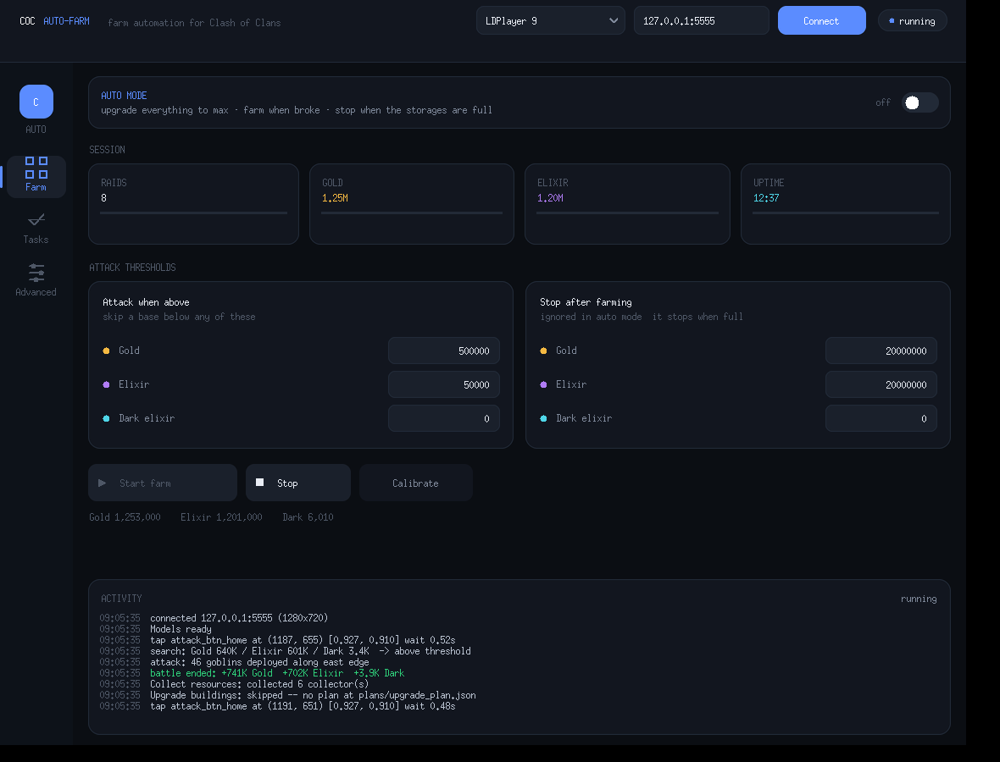
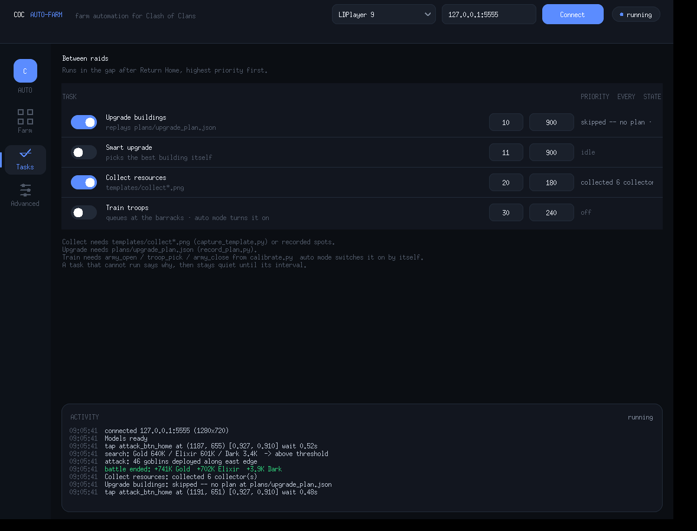
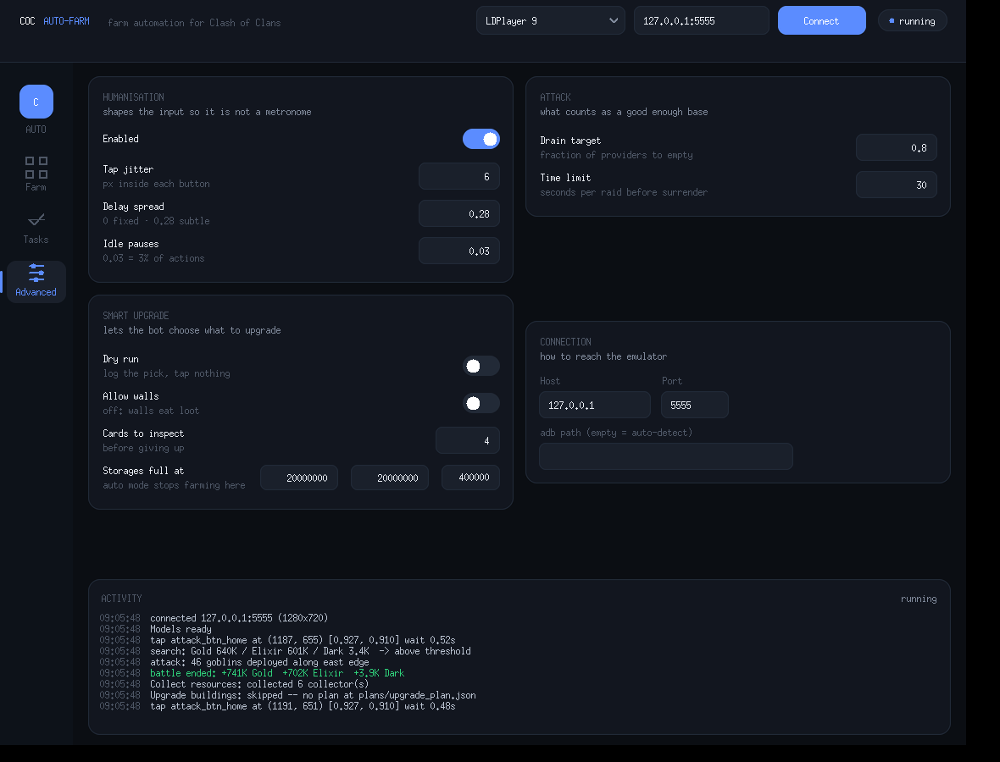

<div align="center">

# 🥔 COC Auto-Farm

**Bot farming Clash of Clans di emulator Android — upgrade sendiri, farm sendiri, berhenti sendiri.**

[](#-status-kejujuran)
[](https://www.python.org/downloads/)
[](#-instalasi)
[](#-emulator-yang-didukung)
[](#-status-kejujuran)
[](LICENSE)

[](TUTORIAL.md)
[](../../releases/latest)
[](../../issues)



</div>

---

## ⚠️ Status kejujuran

**Belum 100% work.** Ini beta yang jalan, bukan produk jadi. Yang sudah terbukti
dan yang belum, dipisah jelas — jangan sampai kecewa karena ekspektasi salah:

| Bagian | Status | Bukti |
|---|---|---|
| Logika keputusan (tier upgrade, auto mode, scheduler, humanizer) | ✅ **jalan** | 66 unit check lulus, `python tests/test_core.py` |
| GUI (layout, render, state, kalibrasi hand-off) | ✅ **jalan** | dirender per halaman, dicek visual |
| Simpan/muat `settings.json` | ✅ **jalan** | dibaca ulang setelah kalibrasi |
| ADB connect / tap / screencap | 🟡 **kode siap, belum diuji lawan emulator nyata** | — |
| OCR baca kartu upgrade | 🟡 **kode siap, belum diuji di game nyata** | — |
| Deteksi bubble upgrade hijau | 🟡 **kode siap, belum diuji di game nyata** | — |
| Auto mode end-to-end (upgrade → farm → hold) | 🔴 **belum pernah jalan penuh di akun nyata** | — |
| Training di barak | 🟡 **kode siap**, frame-diff dites pakai numpy sintetis | — |

Artinya: **mesinnya dites, matanya belum.** Semua yang butuh melihat layar
(OCR, template, deteksi bubble) belum pernah ketemu Clash of Clans sungguhan
dari sisi developer — box develop-nya nggak punya emulator. Kalau kamu jalanin
dan ada yang aneh, itu ekspektasi, bukan kejutan.

Pertama kali pakai: nyalain **Dry run** di Advanced dulu. Bot bakal nge-log apa
yang *mau* dia lakuin tanpa nge-tap apa pun.

---

## ✨ Fitur

- 🧠 **Smart upgrade** — bot yang milih mau upgrade apa. Baca kartu lewat OCR,
  cocokin ke kamus 45 building, urutin pakai tier (offence dulu, wall terakhir).
- 🔁 **Auto mode** — satu switch. Upgrade semua sampai max (Town Hall ikut),
  farm kalau duit habis, berhenti sendiri kalau storage penuh.
- 🏰 **Multi-emulator** — LDPlayer, MuMu, BlueStacks, MEmu, Nox, AVD, Waydroid,
  atau host:port manual. Ganti emulator cuma pilih dari dropdown.
- 🧩 **Task layer** — collect collector, training barak, upgrade plan, jalan di
  sela raid tanpa nyetop bot.
- 🎭 **Humanised input** — tap jitter di dalam disc, delay log-normal, pause acak.
- 🖥️ **GUI sendiri** — rounded card anti-aliased (Pillow), sidebar, toggle switch.
  Bukan ttk bawaan OS.
- 📸 **ADB-only** — screenshot & tap lewat ADB, jendela emulator boleh diminimize.

<div align="center">

| Farm | Tasks | Advanced |
|---|---|---|
|  |  |  |

</div>

---

## 🚀 Instalasi

Butuh: **Windows 10/11**, **Python 3.11/3.12** (3.13 rusak di torch), emulator,
dan Clash of Clans yang sudah login **di dalam emulator**.

```bat
:: 1. extract ke C:\coc-autofarm  (jangan di OneDrive)
:: 2. buka cmd di folder itu, lalu:
run.bat
```

Run pertama bikin `.venv` + download dependency (beberapa GB, 5–15 menit).
Selesai → window app kebuka.

Manual, kalau nggak mau lewat `run.bat`:

```bat
py -3.12 -m venv .venv
.venv\Scripts\python.exe -m pip install -r requirements.txt
.venv\Scripts\python.exe main.py
```

Panduan lengkap dari nol (termasuk cara extract APK, port tiap emulator, dan
troubleshooting): **[TUTORIAL.md](TUTORIAL.md)**.

---

## 🎮 Emulator yang didukung

| Emulator | Port pertama | Step | ADB di mana |
|---|---|---|---|
| LDPlayer 9 | 5555 | +2 | Settings → Others → ADB local connection |
| MuMu Player 12 | 16384 | +32 | Settings → Advanced → ADB debugging |
| BlueStacks 5 | 5555 | +10 | Settings → Advanced → Android Debug Bridge |
| MEmu | 21503 | +10 | Settings → ADB |
| NoxPlayer | 62001 | +1 | Settings → General → Root/ADB |
| Android Studio AVD | `emulator-5554` | — | start dari Device Manager |
| Genymotion | 6555 | +1 | start virtual device dulu |
| Waydroid / lain | manual | — | tulis `host:port` di header |

Port 5555 dipakai LDPlayer **dan** BlueStacks — auto-scan coba port profile dulu,
lalu fallback ke `adb devices`.

> Resolusi jangan diubah setelah kalibrasi. Set sekali (1280×720, DPI 240).

---

## ⚙️ Cara pakai, singkat

1. **Connect** — pilih emulator di header, tekan Connect. Chip hijau = siap.
2. **Calibrate** — tombol di sebelah Start. Klik 11 titik di screenshot, Save.
   App baca ulang sendiri, nggak perlu restart.
3. **Start farm** — buat ngerasain raid manual dulu.
4. **AUTO MODE** — nyalain, tombol jadi *Start auto*. Dari situ dia jalan sendiri.

### Auto mode, alurnya

```
   builder bebas ──▶ UPGRADE  (1 barang per raid, tier terbaik dulu)
                        │
                        ▼
                    FARM  ◀── tukang penuh
                        │
              storage penuh?
                        ▼
                     HOLD  ── tukang bebas ──▶ balik UPGRADE
                        │
                  3 jam penuh
                        ▼
                     STOP (notif)
```

- **Wall** otomatis ikut: pas semua tukang penuh, wall satu-satunya yang masih
  nyedot loot.
- **"Penuh"** diukur dua cara — cap storage di Advanced, dan stall counter
  (4 raid beruntun tanpa hasil) buat kalau OCR nggak bisa baca bar.
- **Training** dinyalakan otomatis kalau tombol baraknya sudah dikalibrasi.

---

## 🧠 Gimana bot-nya "liat"

Nggak ada koordinat hardcode buat upgrade. Alurnya:

1. **Cari bubble** — game nempelin panah hijau di building yang bisa di-upgrade.
   Dicocokin ke `templates/upgrade_arrow.png`, atau mask warna kalau template
   belum ada.
2. **Baca kartu** — tap, OCR popup, cocokin judulnya ke kamus 45 nama building.
3. **Ranking** — tier table: Town Hall & offence di atas, wall paling bawah.
4. **Cek harga** — angka terdekat tombol Upgrade (bukan angka terbesar di kartu,
   karena HP building maxed juga gede), dibandingin ke isi storage.

Kalau nama building nggak kebaca → **skip**, nggak nebak.

---

## 🗂️ Struktur

| File | Isi |
|---|---|
| `main.py` | wiring: config → adb → vision → bot → GUI |
| `bot.py` | farm loop + auto-mode cycle |
| `automode.py` | state machine UPGRADE / FARM / HOLD / STOP |
| `planner.py` | tier table, parsing harga, ranking kandidat |
| `tasks.py` | Collect / Train / Upgrade / Smart upgrade + scheduler |
| `emulator.py` | profil emulator, port, discovery |
| `adb.py` | connect, screencap, tap, swipe |
| `humanize.py` | jitter, delay log-normal, pause |
| `gui.py` + `ui_kit.py` | window + widget rounded (Pillow) |
| `calibrate.py` | kalibrasi tombol |
| `capture_template.py` | crop template collector |
| `record_plan.py` | rekam plan upgrade |
| `tests/test_core.py` | 66 check logika |

---

## 🧪 Test

```bash
python tests/test_core.py
```

66 check: geometri jitter, distribusi delay, aritmetika port, ranking upgrade,
parsing harga, transisi auto mode, deteksi antrian penuh, urutan scheduler.
Nggak butuh emulator, nggak butuh OpenCV.

---

## 🐞 Kalau ada masalah

| Gejala | Sebab | Fix |
|---|---|---|
| `Cannot start: button positions missing` | kalibrasi belum ke-save | tekan **Calibrate**, set 11 tombol, Save |
| `ADB Error` | emulator mati / ADB off / port salah | nyalain ADB, cek port di setting emulator |
| Tap jalan tapi game diem | resolusi berubah setelah kalibrasi | balikin resolusi, atau kalibrasi ulang |
| `no upgrade bubbles` | tukang penuh / nggak ada yang affordable | normal, dia farming |
| Collect nggak pernah jalan | belum ada template | `capture_template.py` |
| Train bilang `calibrate:` | tombol 12–14 belum diset | kalibrasi ulang |

Sisanya: [TUTORIAL.md](TUTORIAL.md) bagian troubleshooting.

---

## ⚖️ Catatan legal & risiko

- Project ini **melanggar Terms of Service Supercell**. Akun bisa — dan sering —
  kena ban. Pakai akun yang kamu rela kehilangan.
- Humanizer bikin input nggak mekanis. Itu **mengurangi** sinyal deteksi, bukan
  menghilangkan.
- Nggak ada jaminan profit. Ini alat, bukan mesin uang.
- Repo ini edukasi/otomasi pribadi. Kamu yang pakai, kamu yang nanggung.

---

## 📄 Lisensi

MIT — lihat [LICENSE](LICENSE).
Berdasarkan [anugrhaswi/Coc-Auto-Farm](https://github.com/anugrhaswi/Coc-Auto-Farm).
